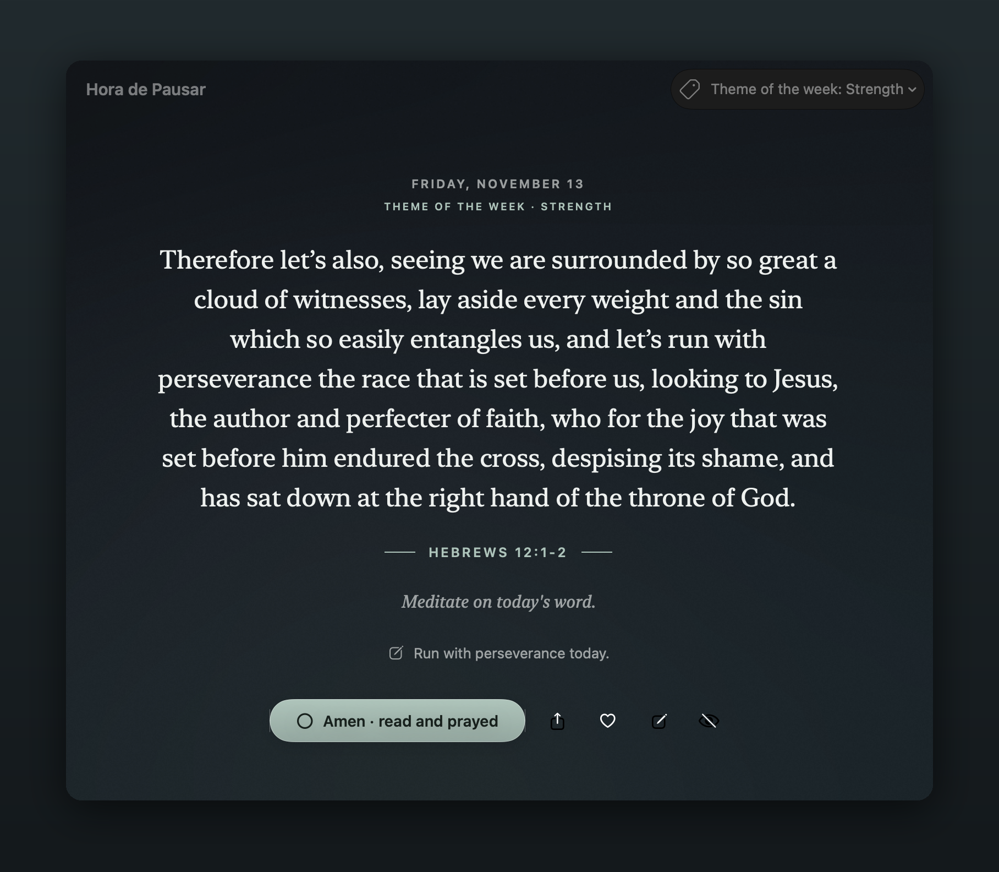
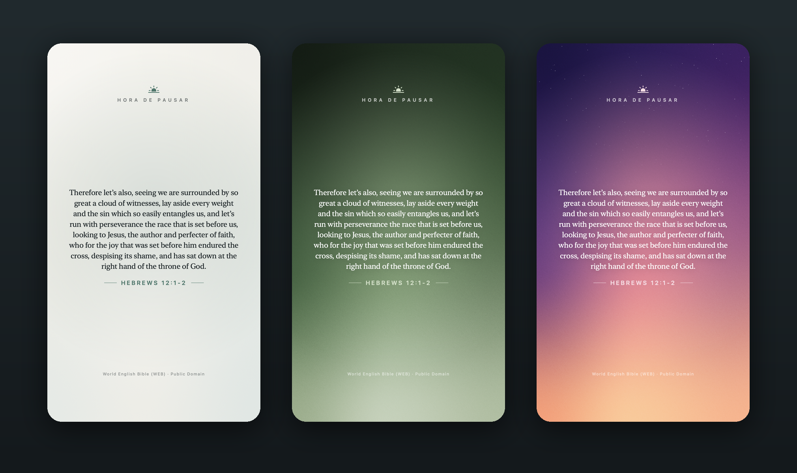
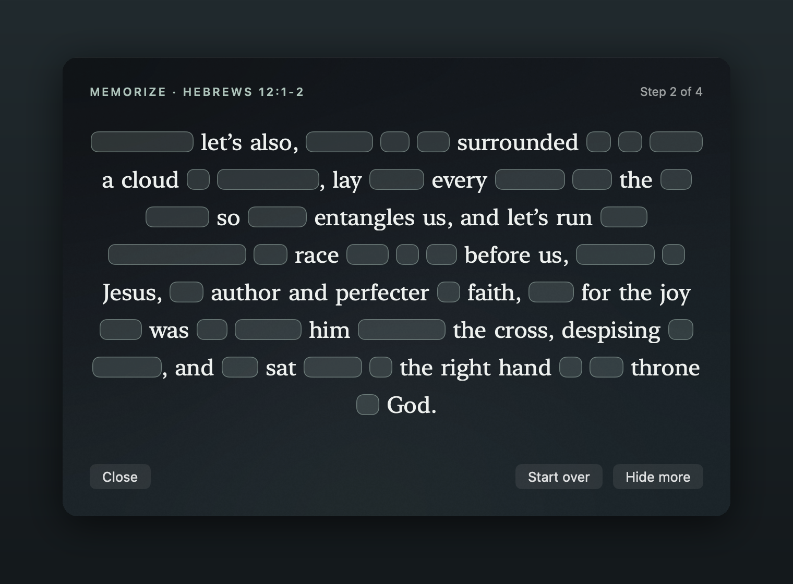

<div align="center">

**English** · [Português (Brasil)](README.pt-BR.md)

# Hora de Pausar

**A quiet daily pause for the Bible, built into the macOS menu bar.**

At the time you choose each day, Hora de Pausar shows a short Bible passage so you can stop,
read, pray and go back to your day.

<a href="#requirements"></a>


<a href="#tests"></a>
<a href="#architecture"></a>
<a href="#bible-text-and-license"></a>


[Why it exists](#why-it-exists) · [Features](#what-it-does) · [Build and run](#build-and-run) · [Tests](#tests) · [Architecture](#architecture) · [Bible text](#bible-text-and-license)



</div>

---

## Why it exists

A busy workday leaves little room to stop. Hora de Pausar makes the pause part of the schedule:
once a day, at your time, a calm card appears in the corner of the screen with one passage. You
read it, pray, and tap **"Amen · read and prayed"**. That's the whole habit: one passage, a few quiet
minutes, every day.

The app stays out of the way. It lives in the menu bar, has no account and no ads, collects no
data and doesn't need the internet. Everything it knows about you stays on your Mac.

## What it does

- **Daily passage at your time.** Pick the hour in Settings. The reminder is an elegant card in
  the corner of the screen, a macOS notification, or both, with an optional soft sound.
- **365 curated passages.** One for each day of the year, with no repeat until the year is up.
  Each passage belongs to a theme: peace, strength, trust, gratitude, hope, love, wisdom or
  prayer.
- **Theme of the week.** Pick a theme and the week's passages come from it. It resets on Monday.
- **This week.** A 7-day strip in the sidebar shows which days you read, plus your current
  streak.
- **Note.** Write a short personal note on the day's passage. Notes are kept in the **Journal**.
- **Memorize.** Memorize the passage step by step: each round hides more words until you can
  say it from memory.
- **Favorites and Passages.** Keep the passages that spoke to you, and browse all 365.
- **Share as an image.** Turn any passage into an image for Instagram Stories, a post or a
  WhatsApp Status. Pick from three formats, six backgrounds and two typefaces.
- **Evening reminder.** If the passage is still unread at night (21:00 by default), you get one
  gentle reminder.
- **English or Portuguese.** The whole app, and the passages, switch between English and
  Brazilian Portuguese in Settings. It starts in your Mac's language.
- **Opens at login**, if you want it to.

<p align="center">
  
</p>
<p align="center">
  
</p>

## Requirements

- macOS 26 or later
- Xcode 26 or later, to build from source

## Build and run

```sh
git clone https://github.com/daniell5g/HoraDePausar.git
cd HoraDePausar
open HoraDePausar.xcodeproj   # then Run the "HoraDePausar" scheme
```

Or from the terminal:

```sh
xcodebuild -project HoraDePausar.xcodeproj -scheme HoraDePausar \
  -configuration Release -derivedDataPath build -destination 'platform=macOS' build
open "build/Build/Products/Release/Hora de Pausar.app"
```

The Xcode project is generated from `project.yml` with
[XcodeGen](https://github.com/yonaskolb/XcodeGen). After changing `project.yml`, run
`xcodegen generate`.

> The app is signed ad hoc only, with no Developer ID and no notarization. If you copy a build to
> another Mac, macOS will block it the first time. Allow it in **System Settings › Privacy &
> Security › Open Anyway**.

## Tests

```sh
xcodebuild -project HoraDePausar.xcodeproj -scheme HoraDePausar \
  -configuration Debug -derivedDataPath build -destination 'platform=macOS' test
```

54 tests in 12 suites, written with Swift Testing, cover the rules and use cases: passage
drawing, streaks, the theme of the week, memorize levels, reminder timing, saving state and
switching languages.

## Architecture

The code follows Clean Architecture. The rules know nothing about SwiftUI or AppKit, and the
screens know nothing about how data is stored.

```
Core/                         HoraDePausarCore framework (no UI)
├── Domain/
│   ├── Entities/             Passage, AppState, AppLanguage, ReminderSchedule, EveningReminder, WeekDay
│   ├── Rules/                PassagePicker, Devotion, Streak, Memorize, ReminderPolicy, DayKey
│   └── Ports/                StateRepository (protocol)
├── UseCases/                 DevotionService: everything the app can do
├── Data/                     JSONStateRepository, PassageLibrary (one Bible edition per language)
├── Resources/                passages.json (Portuguese), passages.en.json (English)
└── Layout/                   FloatingPlacement (where the reminder card sits)

App/                          the macOS app
├── Composition/              app entry point; wires repository → service → store
├── Platform/                 menu bar, windows, notifications, reminder timer, open at login
├── Presentation/             SwiftUI screens, the view model (DevotionStore) and Localization
└── Tooling/                  Debug-only demo and screenshot runner, not in Release builds

Tests/                        Swift Testing suites
```

Dependencies point inward: `App → UseCases → Domain`, and `Data` implements the domain's
`StateRepository` port.

Your history is saved as JSON in `~/Library/Application Support/com.danielmarques.selah/` on your
Mac. The bundle id still uses the app's first code name, so existing history carries over.

## Bible text and license

Both languages use the same 365 passages and themes.

**English.** The passages come from the **World English Bible (WEB)**, 2020 stable text edition,
which is in the public domain. "World English Bible" is a trademark of eBible.org.
Source: [worldenglish.bible](https://worldenglish.bible/) ·
[copyright](https://ebible.org/engwebp/copyright.htm). Formatting changes: the passages are
excerpts, so footnotes and headings were removed, and a closing quote or final period was added
where a passage ends mid-sentence. Every English share image carries the credit
*World English Bible (WEB) · Public Domain*. `extract_web.py` builds the English set from the WEB
USFM files.

**Portuguese.** The passages come from the **Bíblia Livre (BLIVRE)**, February 2018 version, © Diego Santos,
Mario Sérgio and Marco Teles, licensed under
[Creative Commons Atribuição 3.0 Brasil (CC BY 3.0 BR)](https://creativecommons.org/licenses/by/3.0/br/).
Source: [Bíblia Livre](https://sites.google.com/site/biblialivre/) ·
[github.com/blivre/BibliaLivre](https://github.com/blivre/BibliaLivre).

Formatting changes: Psalm titles and brackets removed, final punctuation and some typos fixed.
Every Portuguese share image carries the credit *Bíblia Livre (BLIVRE) · CC BY 3.0 BR*.
`curate_passages.py` is the script that picked the 365 passages and their themes from the source
text.

---

<div align="center">

Made by **TechDaniel's**

</div>
