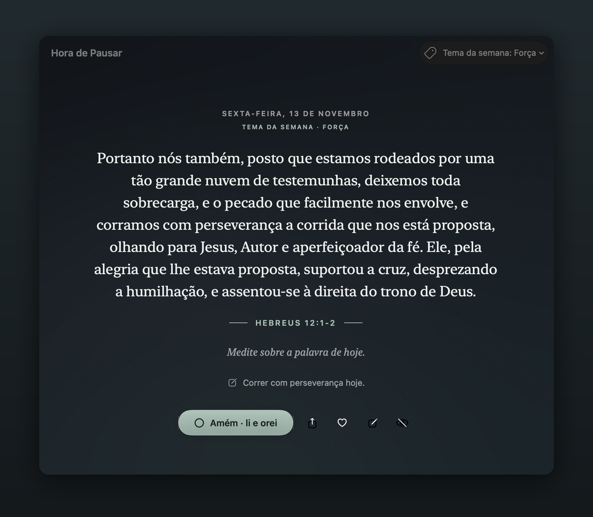
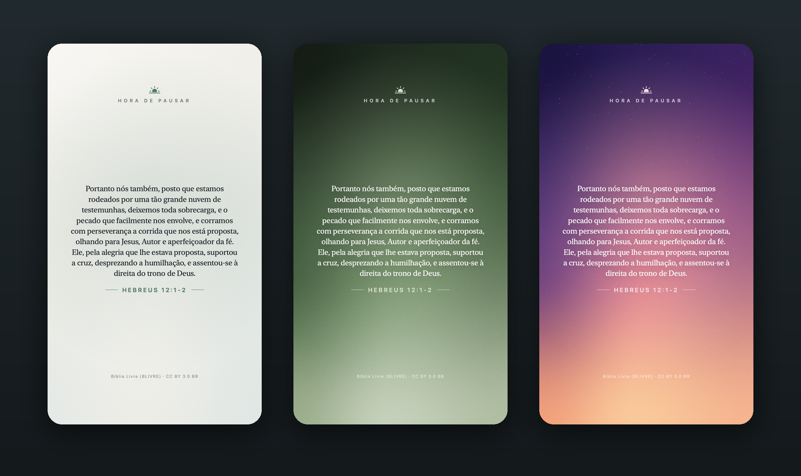
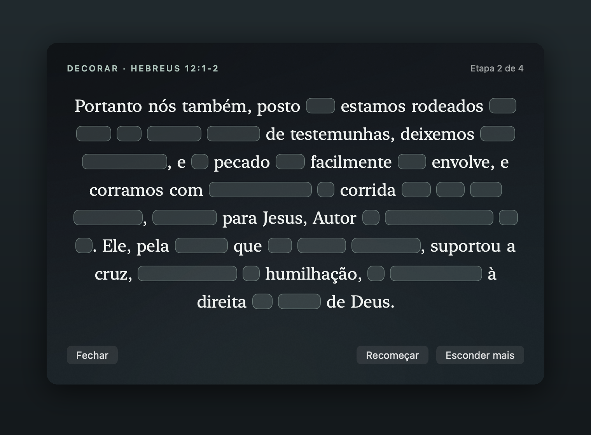

<div align="center">

[English](README.md) · **Português (Brasil)**

# Hora de Pausar

**Uma pausa diária e tranquila com a Bíblia, na barra de menus do macOS.**

No horário que você escolhe, todo dia, o Hora de Pausar mostra uma passagem curta da Bíblia para
você parar, ler, orar e voltar ao seu dia.

<a href="#requisitos"></a>


<a href="#testes"></a>
<a href="#arquitetura"></a>
<a href="#texto-bíblico-e-licença"></a>


[Por que existe](#por-que-existe) · [Recursos](#o-que-faz) · [Compilar e rodar](#compilar-e-rodar) · [Testes](#testes) · [Arquitetura](#arquitetura) · [Texto bíblico](#texto-bíblico-e-licença)



</div>

---

## Por que existe

Um dia de trabalho cheio deixa pouco espaço para parar. O Hora de Pausar coloca a pausa na
agenda: uma vez por dia, no seu horário, um cartão discreto aparece no canto da tela com uma
passagem. Você lê, ora e toca em **"Amém · li e orei"**. O hábito é só isso: uma passagem, alguns
minutos de silêncio, todo dia.

O app não atrapalha. Ele fica na barra de menus, não tem conta nem anúncios, não coleta dados e
não precisa de internet. Tudo o que ele sabe sobre você fica no seu Mac.

## O que faz

- **Passagem diária no seu horário.** Escolha a hora em Ajustes. O lembrete é um cartão elegante
  no canto da tela, uma notificação do macOS ou os dois, com um som suave opcional.
- **365 passagens selecionadas.** Uma para cada dia do ano, sem repetir até o ano acabar. Cada
  passagem pertence a um tema: paz, força, confiança, gratidão, esperança, amor, sabedoria ou
  oração.
- **Tema da semana.** Escolha um tema e as passagens da semana vêm dele. Ele recomeça na
  segunda-feira.
- **Esta semana.** Uma faixa de 7 dias na barra lateral mostra em quais dias você leu, junto com
  a sua sequência atual.
- **Anotar.** Escreva uma nota pessoal curta sobre a passagem do dia. As notas ficam no
  **Diário**.
- **Decorar.** Memorize a passagem passo a passo: cada rodada esconde mais palavras, até você
  conseguir dizê-la de cor.
- **Favoritos e Biblioteca.** Guarde as passagens que falaram com você e navegue pelas 365.
- **Compartilhar como imagem.** Transforme qualquer passagem em uma imagem para Stories do
  Instagram, um post ou o Status do WhatsApp. Escolha entre três formatos, seis fundos e duas
  fontes.
- **Lembrete da noite.** Se a passagem ainda não foi lida à noite (21:00 por padrão), você recebe
  um lembrete gentil.
- **Português ou inglês.** O app inteiro, e as passagens, trocam entre português do Brasil e
  inglês em Ajustes. Ele começa no idioma do seu Mac.
- **Abre ao iniciar a sessão**, se você quiser.

<p align="center">
  
</p>
<p align="center">
  
</p>

## Requisitos

- macOS 26 ou mais recente
- Xcode 26 ou mais recente, para compilar a partir do código

## Compilar e rodar

```sh
git clone https://github.com/daniell5g/HoraDePausar.git
cd HoraDePausar
open HoraDePausar.xcodeproj   # depois rode o esquema "HoraDePausar"
```

Ou pelo terminal:

```sh
xcodebuild -project HoraDePausar.xcodeproj -scheme HoraDePausar \
  -configuration Release -derivedDataPath build -destination 'platform=macOS' build
open "build/Build/Products/Release/Hora de Pausar.app"
```

O projeto do Xcode é gerado a partir do `project.yml` com o
[XcodeGen](https://github.com/yonaskolb/XcodeGen). Depois de alterar o `project.yml`, rode
`xcodegen generate`.

> O app tem só assinatura ad hoc, sem Developer ID e sem notarização. Se você copiar um build para
> outro Mac, o macOS vai bloqueá-lo na primeira vez. Libere em **Ajustes do Sistema › Privacidade e
> Segurança › Abrir Mesmo Assim**.

## Testes

```sh
xcodebuild -project HoraDePausar.xcodeproj -scheme HoraDePausar \
  -configuration Debug -derivedDataPath build -destination 'platform=macOS' test
```

54 testes em 12 suítes, escritos com Swift Testing, cobrem as regras e os casos de uso: sorteio
das passagens, sequências, tema da semana, níveis do Decorar, horário dos lembretes, gravação do
estado e troca de idioma.

## Arquitetura

O código segue Clean Architecture. As regras não sabem nada de SwiftUI ou AppKit, e as telas não
sabem nada de como os dados são guardados.

```
Core/                         framework HoraDePausarCore (sem interface)
├── Domain/
│   ├── Entities/             Passage, AppState, AppLanguage, ReminderSchedule, EveningReminder, WeekDay
│   ├── Rules/                PassagePicker, Devotion, Streak, Memorize, ReminderPolicy, DayKey
│   └── Ports/                StateRepository (protocolo)
├── UseCases/                 DevotionService: tudo o que o app sabe fazer
├── Data/                     JSONStateRepository, PassageLibrary (uma Bíblia por idioma)
├── Resources/                passages.json (português), passages.en.json (inglês)
└── Layout/                   FloatingPlacement (onde o cartão do lembrete aparece)

App/                          o app macOS
├── Composition/              ponto de entrada; liga repositório → serviço → store
├── Platform/                 barra de menus, janelas, notificações, timer do lembrete, abrir ao iniciar
├── Presentation/             telas SwiftUI, o view model (DevotionStore) e Localization
└── Tooling/                  demo e capturas de tela só em Debug, fora dos builds Release

Tests/                        suítes de Swift Testing
```

As dependências apontam para dentro: `App → UseCases → Domain`, e `Data` implementa a porta
`StateRepository` do domínio.

O seu histórico é salvo em JSON em `~/Library/Application Support/com.danielmarques.selah/` no
seu Mac. O bundle id ainda usa o primeiro codinome do app, então o histórico existente continua.

## Texto bíblico e licença

Os dois idiomas usam as mesmas 365 passagens e temas.

**Português.** As passagens vêm da **Bíblia Livre (BLIVRE)**, versão de fevereiro de 2018, © Diego Santos,
Mario Sérgio e Marco Teles, licenciada sob
[Creative Commons Atribuição 3.0 Brasil (CC BY 3.0 BR)](https://creativecommons.org/licenses/by/3.0/br/).
Fonte: [Bíblia Livre](https://sites.google.com/site/biblialivre/) ·
[github.com/blivre/BibliaLivre](https://github.com/blivre/BibliaLivre).

Alterações de formatação: títulos dos Salmos e colchetes removidos, pontuação final e alguns
erros de digitação corrigidos. Toda imagem compartilhada em português leva o
crédito *Bíblia Livre (BLIVRE) · CC BY 3.0 BR*. `curate_passages.py` é o script que escolheu as
365 passagens e seus temas a partir do texto original.

**Inglês.** As passagens vêm da **World English Bible (WEB)**, edição de texto estável de 2020,
que está em domínio público. "World English Bible" é marca registrada da eBible.org.
Fonte: [worldenglish.bible](https://worldenglish.bible/) ·
[copyright](https://ebible.org/engwebp/copyright.htm). Alterações de formatação: as passagens são
trechos, então notas de rodapé e títulos foram removidos, e uma aspa de fechamento ou ponto final
foi acrescentado quando o trecho termina no meio da frase. Toda imagem compartilhada em inglês
leva o crédito *World English Bible (WEB) · Public Domain*. `extract_web.py` monta as passagens em
inglês a partir dos arquivos USFM da WEB.

---

<div align="center">

Feito por **TechDaniel's**

</div>
